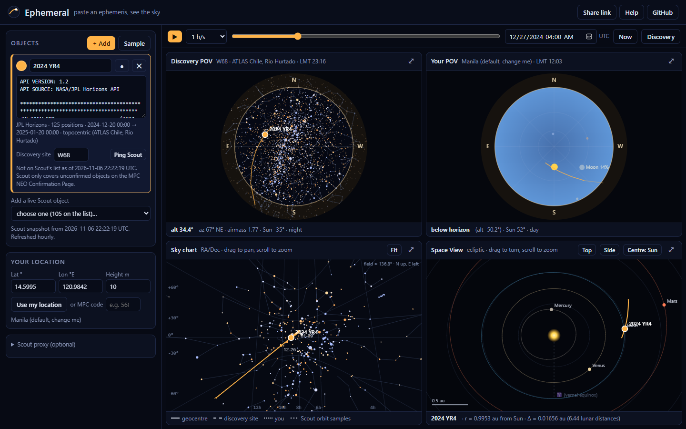
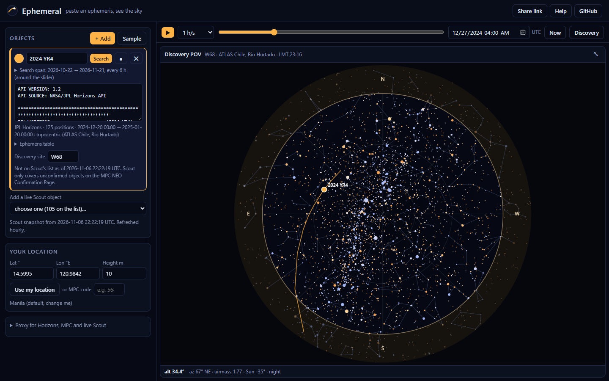
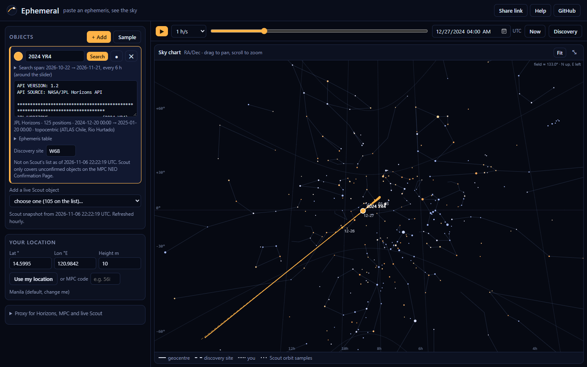
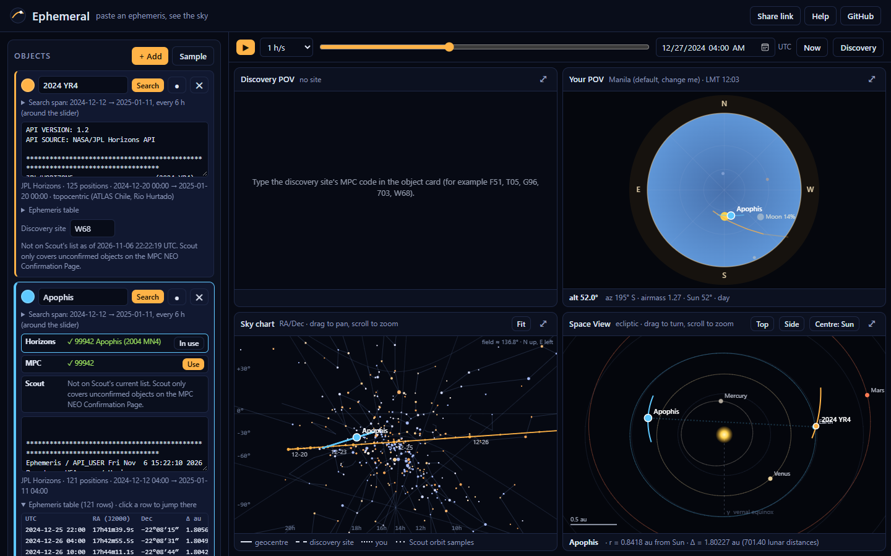
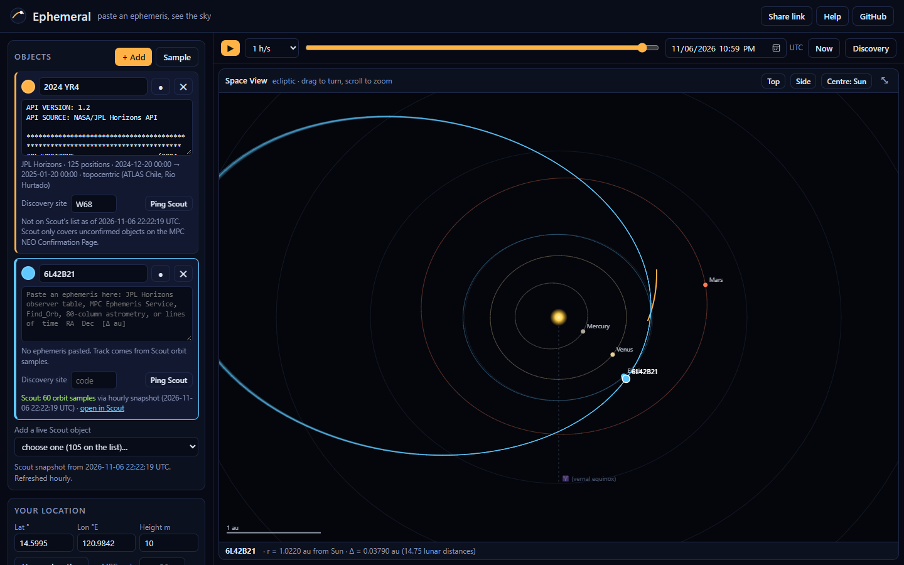

# Ephemeral

[](https://github.com/eagnespuerto/ephemeral/actions/workflows/pages.yml)
[](https://eagnespuerto.github.io/ephemeral/)
[](https://cneos.jpl.nasa.gov/scout/)
[](#name-search)
[-9be15d)](#run-it-locally)
[](https://github.com/cosinekitty/astronomy)
[](LICENSE)

**A Desmos-style plotter for the sky.** Paste an ephemeris and see the object:

- **a) from the discovery site**, as the discoverers saw it,
- **b) from where you are**, and
- **c) in Space View**, as an orbit arc around the Sun.

Or just **type a name**. Ephemeral searches **JPL Horizons**, the **MPC Ephemeris Service** and **JPL Scout** together, and fills the card with the ephemeris it finds. Scout's tentative orbit samples are drawn as an uncertainty cloud.

**Open it:** https://eagnespuerto.github.io/ephemeral/



## Screenshots

| Discovery POV | Sky chart |
|---|---|
|  |  |
| **2024 YR4 from W68**, 2024 Dec 27 04:00 UTC. Alt 34.4°, matching Horizons to 0.03°. | **RA/Dec chart.** Drag to pan, scroll to zoom. Dashed tracks show parallax per site. |

**Name search.** Type *Apophis* and press Enter. Horizons and MPC both answer, and the Horizons ephemeris goes in. Click *Use* to switch to MPC. The ephemeris table under the card jumps the time slider to any row.



**Space View with a live Scout object.** The faint lines are Scout's orbit samples. The arc in orange is 2024 YR4, built from RA, Dec and Δ.



## What it does

| Panel | What you see |
|---|---|
| **Discovery POV** | All-sky dome from the discovery site (MPC code), with stars, constellations, Sun, Moon and twilight colour. |
| **Your POV** | The same dome from your location. Use the browser location, type lat/lon, or give an MPC code. |
| **Sky chart** | Zoomable RA/Dec chart (gnomonic). Shows the geocentric track with daily ticks, topocentric tracks per site, and the Scout cloud. |
| **Space View** | Heliocentric ecliptic scene with the planets. The ephemeris becomes a 3D arc. Drag to turn, scroll to zoom, centre on the Sun or Earth. |

Other things:

- **Name search** across Horizons, MPC and Scout (see below), with an **ephemeris table** you can click to jump in time.
- A **time slider** with play and speed controls, plus *Now* and *Discovery* buttons.
- **Many objects at once**, each with its own colour, like expressions in Desmos.
- **Share link**: the whole session goes into the URL, compressed. Your own location is left out.
- **Live Scout list**: pick any object now on the NEO Confirmation Page and see its orbit samples.

## Pasting an ephemeris

Ephemeral reads these formats:

- **JPL Horizons** observer tables, as text or CSV. It reads the target name, the observing site and Δ. A topocentric table is turned back into geocentric, so the other site's view is right.
- **MPC Ephemeris Service** and **Find_Orb** output.
- **MPC 80-column astrometry**. The `*` discovery line sets the discovery site and time.
- **Simple tables** such as `2026-11-07T00:00Z, 59.30, -16.03, 0.12` (time, RA, Dec, Δ). Time can be ISO, MPC style or a Julian date.

Sexagesimal RA is in hours; decimal RA is in degrees. Positions are taken as J2000. Without a Δ column you still get the sky views, but not the Space View arc or parallax.

## Name search

Type a name or designation in a card (*Apophis*, *2024 YR4*, *1P*, *C/2023 A3*, *Mars*, or a NEOCP name such as *6L42B21*) and press Enter. Ephemeral asks three services at once:

| Source | What it returns | Needs the proxy? |
|---|---|---|
| **JPL Horizons** | Geocentric observer table (RA, Dec, Δ, mag) from JPL's orbit. Comets get their latest apparition. Ambiguous names, like *Mars* or *Halley*, show a list to pick from. | Yes |
| **MPC Ephemeris Service** | Geocentric ephemeris from the MPC orbit (up to 1441 rows). | Yes |
| **JPL Scout** | For unconfirmed NEOCP objects: the mean of Scout's orbit samples, plus the sample cloud. | No (hourly snapshot) |

The best answer fills the card: Horizons first, then MPC, then Scout. Click *Use* on another row to switch. The ephemeris is geocentric, and Ephemeral works out each site's view from Δ. Set the time span and step under the name. By default it covers 15 days either side of the slider, every 6 hours.

On the Apophis test the MPC and Horizons positions agree to 0.6″.

## The proxy (Cloudflare Worker)

Horizons, the MPC Ephemeris Service and Scout do not send CORS headers, so a page on another site cannot call them. (The MPC's newer JSON API needs GET requests with a body, which browsers cannot send at all.) [`worker/ephemeral-proxy.js`](worker/ephemeral-proxy.js) is a small Cloudflare Worker that forwards only those services:

```bash
cd worker && npx wrangler deploy
```

Paste the Worker's URL (for example `https://ephemeral-proxy.<you>.workers.dev`) into **Proxy for Horizons, MPC and live Scout** in the sidebar, then click *Test*. `ALLOWED_ORIGINS` in [`worker/wrangler.toml`](worker/wrangler.toml) limits which sites may use it.

Without a proxy:

- Scout still works through the **hourly snapshot**. The [Pages workflow](.github/workflows/pages.yml) runs [`tools/fetch_scout.py`](tools/fetch_scout.py) every hour, saves every Scout object with 60 orbit samples, and deploys them with the site.
- The Horizons row gives an *Open Horizons* link with the ephemeris ready, which you can copy and paste into the card.

Scout only covers unconfirmed objects on the NEO Confirmation Page. Designated objects such as 2024 YR4 are not on it, and the card says so.

## Accuracy

These are the checks we ran on 2024 YR4 at 2024 Dec 27 04:00 UTC, against JPL Horizons (airless alt/az):

| Site | Ephemeral | Horizons |
|---|---|---|
| W68 ATLAS Chile | alt 34.40°, az 67.41° | alt 34.37°, az 67.44° |
| Manila (from the W68 table, via parallax) | alt −50.25°, az 286.77° | alt −50.27°, az 286.78° |

The small differences come from linear interpolation between 6-hour rows.

Scout orbit samples are propagated as plain two-body orbits. For a Scout object 0.04 au away, this lands within about 1′ of Scout's own ephemeris. That is fine for a picture, but **don't use it to point a telescope**. Use the Scout or NEOCP ephemeris for that.

## Run it locally

There is no build step.

```bash
git clone https://github.com/eagnespuerto/ephemeral.git
```

```bash
cd ephemeral && python tools/fetch_scout.py && python -m http.server 8765
```

Then open http://localhost:8765. For name search, run the local stand-in for the Worker and set the proxy to `http://localhost:8787`:

```bash
python tools/dev_proxy.py
```

To regenerate the screenshots (needs Python Playwright, Microsoft Edge, and the dev proxy for the search shot):

```bash
python tools/screenshots.py
```

[`tools/build_static_data.py`](tools/build_static_data.py) rebuilds the star, constellation and observatory-code files.

## Layout

```
index.html            page shell
css/style.css
js/parse.js           ephemeris formats -> rows
js/astro.js           frames, parallax, Kepler propagation (on Astronomy Engine)
js/model.js           objects, tracks, Scout clouds
js/dome.js            Discovery POV / Your POV
js/chart.js           RA/Dec chart
js/space.js           Space View
js/scout.js           Scout lookup (proxy -> live -> snapshot)
js/search.js          name search: Horizons, MPC, Scout
data/                 stars, constellation lines, MPC obscodes, sample ephemeris
tools/                data and Scout snapshot scripts, dev proxy, screenshots
worker/               Cloudflare Worker proxy for Horizons, MPC and Scout
```

## Credits

- Positions of the Sun, Moon, planets and observers: [Astronomy Engine](https://github.com/cosinekitty/astronomy) by Don Cross (MIT).
- Stars to V = 6 and constellation lines: [d3-celestial](https://github.com/ofrohn/d3-celestial) by Olaf Frohn (BSD-3, see [`data/LICENSE-d3-celestial.txt`](data/LICENSE-d3-celestial.txt)).
- Observatory codes: [Minor Planet Center](https://www.minorplanetcenter.net/iau/lists/ObsCodes.html).
- Tentative orbits: [NASA/JPL CNEOS Scout](https://cneos.jpl.nasa.gov/scout/).
- Ephemerides from name search: [JPL Horizons](https://ssd.jpl.nasa.gov/horizons/) and the [MPC Ephemeris Service](https://minorplanetcenter.net/iau/MPEph/MPEph.html).
- Sample ephemeris: [JPL Horizons](https://ssd.jpl.nasa.gov/horizons/).

## License

[MIT](LICENSE) © 2026 Ella Agnes Puerto
